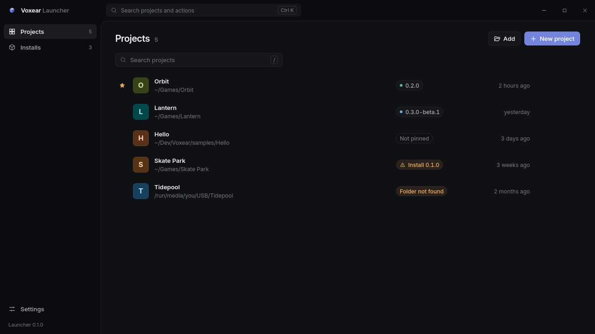

# Voxear Launcher

Install versions of the [Voxear](https://github.com/CookieJarTools/Voxear) game engine, keep your projects in one
list, and open each project with the engine version it was made for. The Voxear Launcher is to Voxear what Unity Hub
is to Unity.



> [!NOTE]
> Voxear and its launcher are in early development. Nightly engine builds for Linux are published, but the launcher
> itself has no release yet, so for now you build it from source (see [Building from source](#building-from-source)).

## Features

- **All your projects in one place.** Search them, star your favourites, and see at a glance which engine version
  each one uses and when you last opened it. If a project needs a version you don't have, the launcher offers to
  install it.
- **Engine versions side by side.** Install stable, beta and nightly versions, keep as many as you like, and remove
  the ones no project uses. An engine you built yourself can be added too.
- **Safe downloads.** Before anything is unpacked, the launcher checks each engine download's size, its SHA-256
  checksum and its signature, so a damaged or tampered file is never installed.
- **New projects from templates.** Pick a template, a name and a folder, and the engine sets the project up. You
  can also set up Git and your code editor at the same time.
- **Moving a project to another engine version.** The launcher backs the project up first, so you can always go
  back.
- **Optional parts.** Choose what comes with each engine version, such as the offline Voxear Manual. Anything you
  leave out can be added later from **Installs**, without installing the version again.
- **A command line for everything.** `voxup` does all of the above from a terminal, for scripts and build servers.
- **Keeps itself up to date.** The launcher updates itself from signed releases, checked the same way as the engine.

## Requirements

- **Linux** (x86-64) or **Windows 10 or 11**.
- Published engine versions are Linux only for now. On Windows, you can add an engine you built from source.

## Building from source

You need:

- [Rust](https://rustup.rs) 1.90 or newer
- A C compiler (used for zstd)
- For the launcher window: [Node.js](https://nodejs.org) 20 or newer, plus Tauri's system packages. On Arch Linux
  that's `webkit2gtk-4.1`; on other systems, see
  [Tauri's prerequisites](https://v2.tauri.app/start/prerequisites/). Windows already has what the window needs.

Get the code:

```bash
git clone https://github.com/CookieJarTools/VoxearLauncher.git
```

```bash
cd VoxearLauncher
```

### The launcher window

```bash
cd app && npm install
```

```bash
npm run tauri build
```

This makes an AppImage and a `.deb` on Linux, and an installer on Windows, in `app/src-tauri/target/release/bundle/`.

### The `voxup` command line

```bash
cargo install --path crates/voxup
```

## Getting started

1. Open the launcher and go to **Installs**.
2. Click **Install a version**, choose the **Nightly** tab, and install the newest version.
3. Go to **Projects** and click **New project**. Pick a template, give the project a name, and click **Create project**.
4. Double-click the project to open it in the Voxear editor.

Already have a Voxear project? Click **Add** on the **Projects** screen and choose its folder.

**Ctrl+K** searches every project, version and action, and **Ctrl+N** starts a new project.

## Using `voxup`

| Command | What it does |
| --- | --- |
| `voxup list --available` | Lists installed engine versions, and those you can install |
| `voxup install stable` | Installs the newest stable version (or `beta`, `nightly`, or a version such as `0.3`) |
| `voxup install 0.3 --without-manual` | Installs a version without the Voxear Manual |
| `voxup uninstall 0.3.0` | Removes a version. It refuses while projects use it, unless you add `--force` |
| `voxup locate <folder>` | Uses an engine installed somewhere else, such as one you built yourself |
| `voxup projects` | Lists your projects, with what each one needs |
| `voxup new Orbit -t third-person --git` | Creates a project from a template |
| `voxup open [folder]` | Opens a project with its engine version. `--install` installs that version first if it's missing |
| `voxup add <folder>` / `voxup remove <folder>` | Adds a project to the list, or takes it off (its files stay) |
| `voxup upgrade [folder] --to 0.3` | Moves a project to another engine version, backing it up first |
| `voxup backups [folder]` / `voxup restore <archive>` | Lists a project's backups, or restores one into a new folder |
| `voxup self update` | Updates `voxup` |

Run `voxup --help`, or `voxup <command> --help`, for every option.

## Where the launcher keeps its files

Engine installs, the project list and settings go in `~/.local/share/voxear` on Linux and `%LOCALAPPDATA%\Voxear` on
Windows. Set `VOXUP_HOME` to use another folder.

## Contributing

Bug reports and ideas are welcome in [Issues](https://github.com/CookieJarTools/VoxearLauncher/issues).

[docs/DESIGN.md](docs/DESIGN.md) explains how the launcher works, including every file format it shares with the
engine and how releases are signed and verified.

### Running the tests

```bash
cargo test
```

The window's commands have tests of their own:

```bash
cd app/src-tauri && cargo test
```

### Working on the window

```bash
cd app && npm run tauri dev
```

`npm run dev` on its own serves the window's front end to an ordinary browser at http://localhost:1430, with
made-up projects and versions, which is handy for working on the look.

### Trying it without real releases

This writes a folder of signed stand-in releases. Each one has a `vox` that can create projects, so you can try the
whole flow without the real engine:

```bash
cargo run -p voxear_launcher --features testing --example fake_release -- /tmp/voxear-mirror
```

It prints two lines for the launcher's settings. To keep the trial away from your real launcher folder, put them in
`/tmp/voxup-home/settings.toml` and point `voxup` there:

```bash
export VOXUP_HOME=/tmp/voxup-home
```

Then try `voxup list --available`, `voxup install stable`, `voxup new Orbit -l /tmp` and `voxup projects`. With
`VOXUP_HOME` still set, `npm run tauri dev` in `app/` opens the window on the same trial folder.

### Publishing releases

`voxear-release` makes the signing keys, signs engine archives and launcher builds, and writes the release feeds
the launcher reads. Releases are published to
[VoxearReleases](https://github.com/CookieJarTools/VoxearReleases). "Publishing releases" in the design explains each
step.

```bash
cargo run -p voxear_release -- --help
```

### Project layout

| Folder | What's in it |
| --- | --- |
| `crates/voxear_launcher` | The core: release feeds, signatures, installs, projects and the new-project flow |
| `crates/voxup` | The `voxup` command line |
| `crates/voxear_release` | The release tool: keys, signing and release feeds |
| `app/` | The launcher window: a React front end in `src/`, and Tauri commands in `src-tauri/` |
| `docs/` | The design |

## Licence

The Voxear Launcher is licensed under the [PolyForm Shield License 1.0.0](LICENSE.md). You may use it and change it,
but not use it to build a product that competes with it.

Required Notice: Copyright 2026 Joseph Cook
